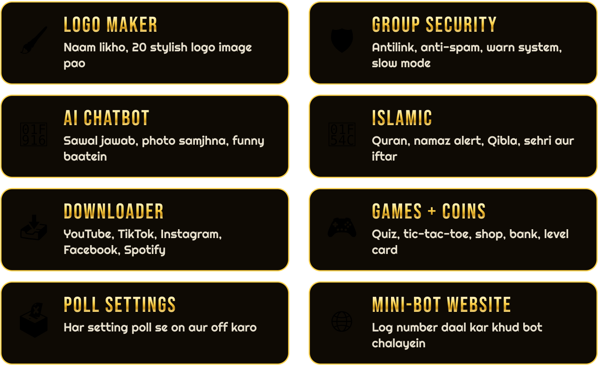

<div align="center">


<a href="#-termux-par-ek-command"></a>
<a href="https://whatsapp.com/channel/0029VbE2Rbj0gcfMoVR1H642"></a>
<a href="https://github.com/Mehdi-1122/Golden-Md/stargazers"></a>
<a href="https://github.com/Mehdi-1122/Golden-Md/fork"></a>


## ✨ Bot mein kya hai



<br><br>


## 📱 Termux par ek command



</div>

Yeh command Termux mein paste karo. Bot apna number poochega, sab khud install karega aur pairing code de dega:

```bash
bash <(curl -fsSL https://raw.githubusercontent.com/Mehdi-1122/Golden-Md/main/install.sh)
```

1. Number likho, misal `03001234567`.
2. Terminal par `🔗 Pairing code` aayega.
3. WhatsApp kholo: **Linked Devices → Link a Device → Link with phone number instead**, aur code daal do.

Agli dafa chalane ke liye: `cd ~/Golden-Md && npm start`

> Termux par `sharp` library nahi banti, is liye sticker wali kuch commands shayad na chalein. Baqi bot chalta rahega.

<div align="center">


## 🚀 Ek click deploy

<a href="https://www.heroku.com/deploy?template=https://github.com/Mehdi-1122/Golden-Md"></a>
<a href="https://app.koyeb.com/deploy?type=git&builder=dockerfile&repository=github.com/Mehdi-1122/Golden-Md&branch=main&name=golden-md&dockerfile=Dockerfile&service_type=worker&command=npm&args=start&env[OWNER_NUMBER]=&env[PAIRING_NUMBER]=&env[MODE]=public"></a>
<a href="https://render.com/deploy?repo=https://github.com/Mehdi-1122/Golden-Md"></a>
<a href="SETUP.md#-vps-ya-pc-par"></a>

</div>

<div align="center">


<a href="https://github.com/Mehdi-1122/Golden-Md/stargazers"></a>

</div>
